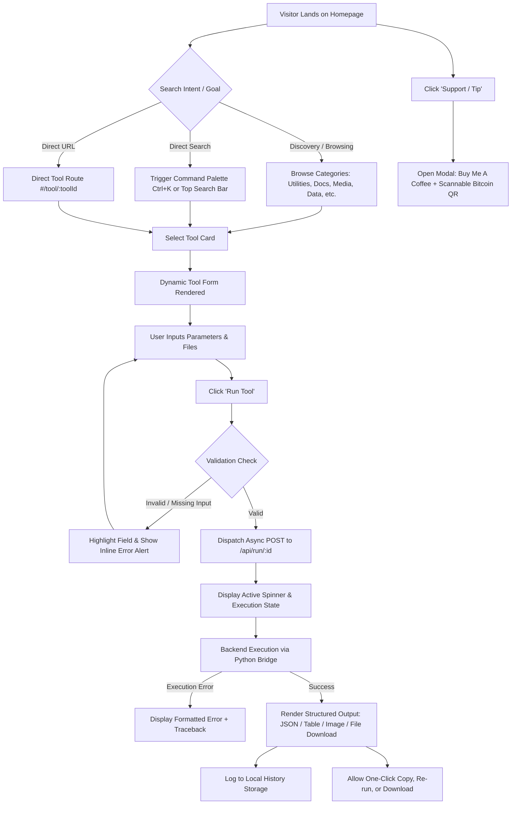

# Application Flow & User Journeys (AppFlow.md)

## 1. High-Level Flowchart

---

## 2. Detailed User Journeys

### Journey 1: Search Engine Traffic & Instant Conversion
1. **Entry**: User searches "free docx to pdf without upload limits" on Google.
2. **Landing**: Crawlable static landing page loads in under 400ms with full semantic markup, high-contrast typography, and explicit privacy guarantees ("Local & In-Memory").
3. **Action**: The user scrolls or searches for "Word to PDF", inputs file or selects local workspace path, and hits Execute.
4. **Result**: Within milliseconds, output appears with a direct download link and execution time badge.

### Journey 2: Keyboard Power User (Command Palette)
1. **Trigger**: User hits `Ctrl + K` (or `Cmd + K` on macOS).
2. **Search**: Types `crypto` or `calc` or `zip`. Fuzzy search instantly highlights matching tools.
3. **Selection**: Presses `Enter` or arrows down to switch immediately to the tool view.
4. **Execution**: Defaults are prefilled for immediate one-click testing.

### Journey 3: Workspace File Exploration & Download
1. **Navigation**: User visits `#/files`.
2. **Interaction**: Views generated QR codes, merged PDFs, or exported CSVs saved in the workspace.
3. **Management**: Direct download or cleanup.
